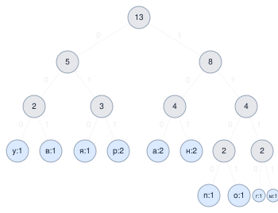

Введіть текст: програмування

Таблиця кодування:
'р': частота = 2, код = 011
'а': частота = 2, код = 100
'н': частота = 2, код = 101
'п': частота = 1, код = 1100
'о': частота = 1, код = 1101
'г': частота = 1, код = 1110
'м': частота = 1, код = 1111
'у': частота = 1, код = 000
'в': частота = 1, код = 001
'я': частота = 1, код = 010

Закодований текст: 1100011110111100111001111000001100101101010
Кількість символів: 13
Унікальних символів: 10
Рівномірний код: 52 біт
Код Хаффмана: 43 біт
Економія: 17.31%

# додаткове завдання:
[add.py](add.py)

У ході практичної роботи було реалізовано алгоритм кодування Хаффмана мовою Python. Для тексту «програмування» довжина закодованого повідомлення становить 43 біти, тоді як при рівномірному кодуванні — 52 біти. Економія становить 17,31%. Додатково реалізовано програму-архіватор, яка забезпечує стиснення та розпакування текстових файлів без втрати інформації.