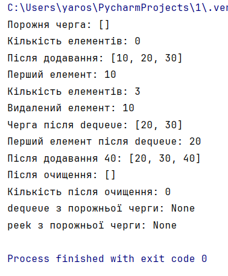

# Практична робота №7

## Код програми

```python
class Queue:
    def __init__(self):
        self.items = []

    def enqueue(self, item):
        self.items.append(item)

    def dequeue(self):
        if not self.items:
            return None
        return self.items.pop(0)

    def peek(self):
        if not self.items:
            return None
        return self.items[0]

    def count(self):
        return len(self.items)

    def clear(self):
        self.items.clear()

    def toString(self):
        return str(self.items)


queue = Queue()

print('Порожня черга:', queue.toString())
print('Кількість елементів:', queue.count())

queue.enqueue(10)
queue.enqueue(20)
queue.enqueue(30)
print('Після додавання:', queue.toString())
print('Перший елемент:', queue.peek())
print('Кількість елементів:', queue.count())

print('Видалений елемент:', queue.dequeue())
print('Черга після dequeue:', queue.toString())
print('Перший елемент після dequeue:', queue.peek())

queue.enqueue(40)
print('Після додавання 40:', queue.toString())

queue.clear()
print('Після очищення:', queue.toString())
print('Кількість після очищення:', queue.count())
print('dequeue з порожньої черги:', queue.dequeue())
print('peek з порожньої черги:', queue.peek())
```

## Результат роботи

Після запуску програми отримав такий результат:

```text
Порожня черга: []
Кількість елементів: 0
Після додавання: [10, 20, 30]
Перший елемент: 10
Кількість елементів: 3
Видалений елемент: 10
Черга після dequeue: [20, 30]
Перший елемент після dequeue: 20
Після додавання 40: [20, 30, 40]
Після очищення: []
Кількість після очищення: 0
dequeue з порожньої черги: None
peek з порожньої черги: None
```



## Перевірка методів

| Метод | Що перевіряв | Результат |
|---|---|---|
| `enqueue()` | Додав 10, 20, 30 | `[10, 20, 30]` |
| `peek()` | Отримав перший елемент | `10` |
| `count()` | Порахував елементи | `3` |
| `dequeue()` | Видалив перший елемент | `10`, залишилось `[20, 30]` |
| `toString()` | Вивів чергу без видалення | `[20, 30]` |
| `clear()` | Очистив чергу | `[]` |
| `dequeue()` і `peek()` | Перевірив порожню чергу | `None` |

